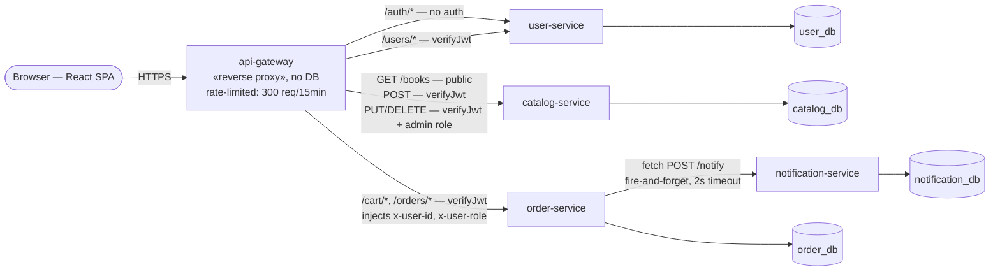
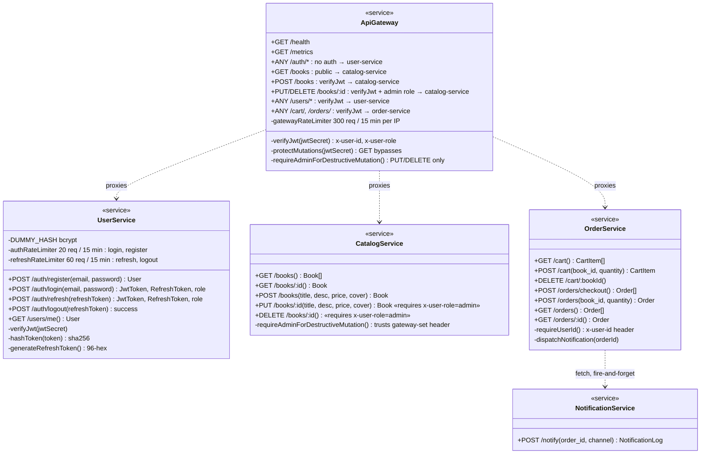
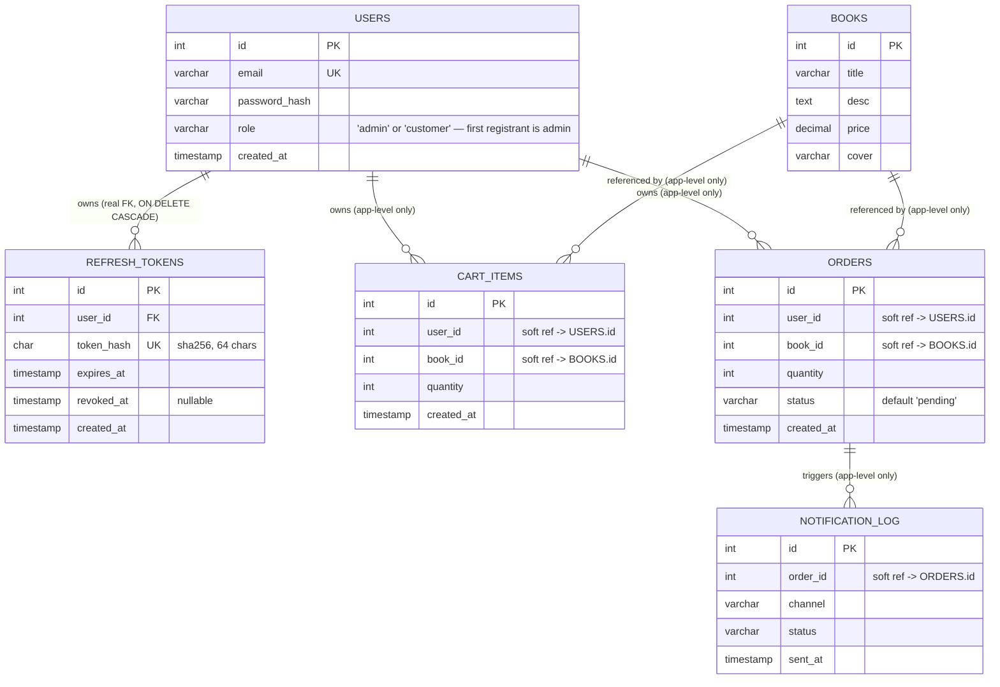
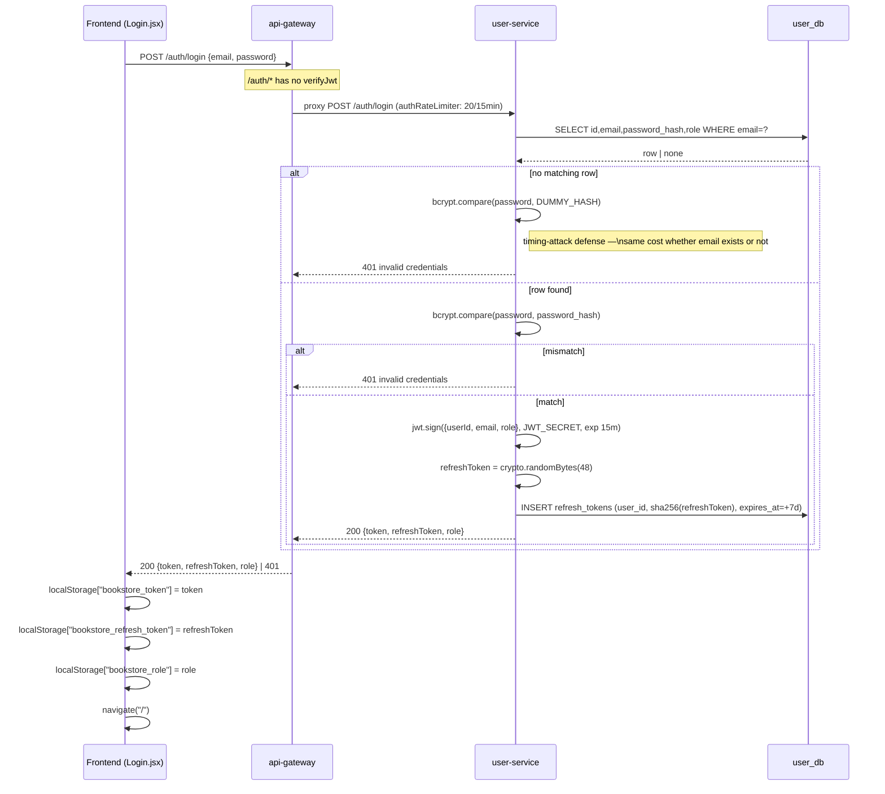
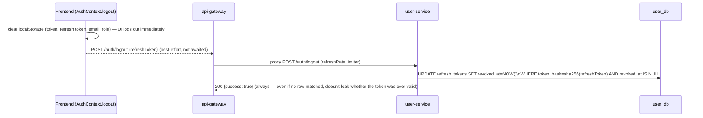
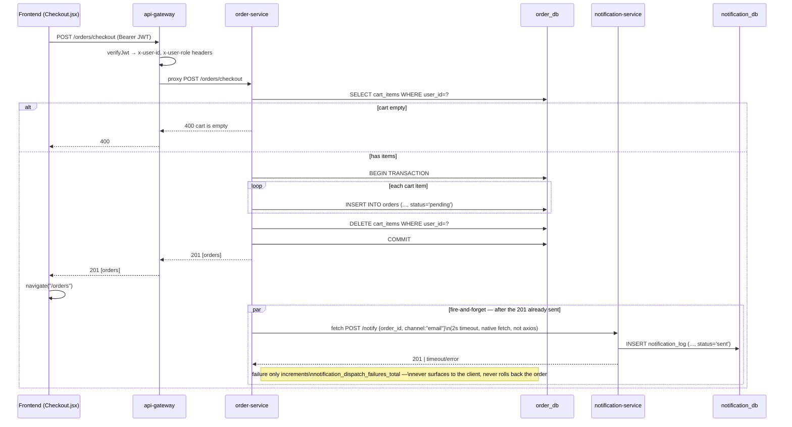
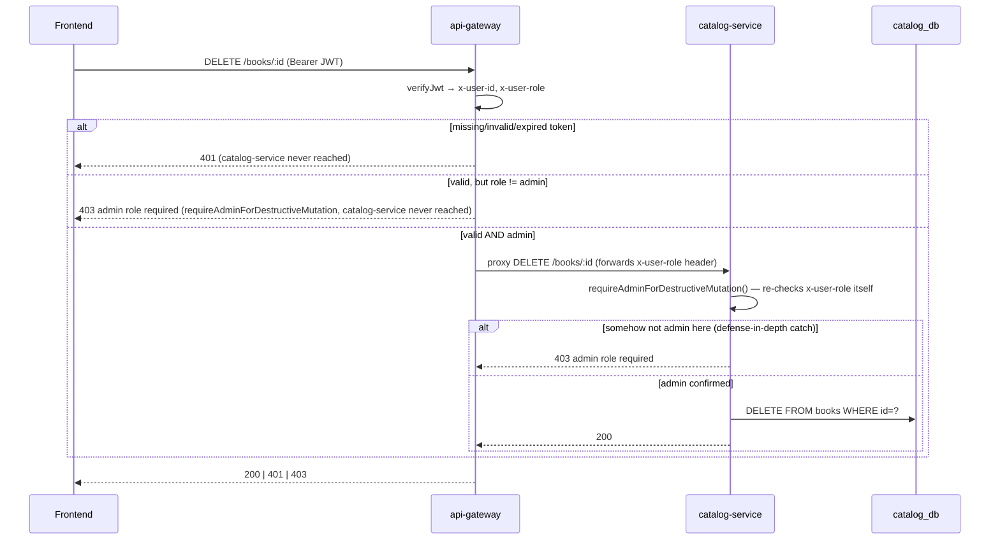
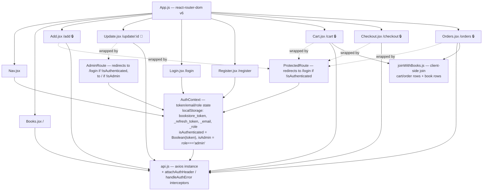

# Application UML

Friends, in this document we will understand the **application** side of the Bookstore through pictures (diagrams). We look at services, data, login, and checkout. Infrastructure is in [`ARCHITECTURE.md`](ARCHITECTURE.md).

**How to read this file:**
- Each diagram has a short "in plain words" section. Read that first.
- The diagrams are written in **Mermaid**. GitHub, GitLab, and most Markdown viewers draw them for you.
- They were checked against the real source: the five services in `services/*` and the React app in `client/src/`.

**Good to know about the code style:**
- Each service is a **flat Express app**: one `app.js` (the app) and one `index.js` (start-up).
- There are **no** `routes/`, `controllers/`, or `models/` folders.
- There is **no ORM**. The code uses raw SQL with `mysql2`.
- The frontend is React with `react-router-dom` v6.

**Easy memory trick:** Component diagram = who talks to whom. Class diagram = what each service offers. ER diagram = what the tables look like. Sequence diagram = the story in time order.

---

## 1. Component diagram — the services



**In plain words:**
- The browser only talks to **api-gateway**.
- The gateway has **no database**. It only checks and forwards.
- Each service owns **one database**.
- The **only** service-to-service call is `order-service → notification-service`.
- `order-service` never calls `catalog-service`. So nobody checks the book price or stock on the server side. The `orders` table does not even store a price.
- Every service also has `GET /health` and `GET /metrics`. They are left out of the picture to keep it clean.

**Real-time example:** Think of the gateway as a hotel reception. It checks your key card (JWT), then sends you to the right floor. It never cooks the food itself.

**Easy memory trick:** One public door (gateway). One database per service. One internal call (order → notification).

---

## 2. Class diagram — what each service offers

These are not real classes. Every service is just functions over a `mysql2` connection pool. So we draw each service as its **public HTTP interface**. Each "method" is a route.



**Who checks the login token (JWT)?**
- **api-gateway** checks it on every protected call. This is the main check.
- **user-service** also checks it, but only for `GET /users/me`. This is a small extra check.
- **order-service** and **notification-service** never check a token. `order-service` simply trusts the `x-user-id` header that the gateway adds.
- **catalog-service** trusts the `x-user-role` header too. It uses it as a **second, separate check** on `PUT` and `DELETE`. This is "defence in depth": two locks, not one.

**The refresh token is different:**
- It is **not a JWT**. It is just random bytes.
- It is never checked by `verifyJwt`.
- `user-service` looks it up in the database using its SHA-256 hash.

**Roles:**
- There are only two roles: `admin` and `customer`.
- The **first account ever registered** becomes `admin`. Everyone after that is `customer`.
- The role is stored **inside the JWT** (`{userId, email, role}`) when you log in or refresh.
- There is **no endpoint to promote** a customer to admin. Only a direct database edit can do it.
- The frontend also saves the role in `localStorage["bookstore_role"]`.

> **Heads up for learners:** the "first account is admin" rule works like this. `user-service` runs a `SELECT COUNT(*)` on `users`, and then does the `INSERT`. These are two separate queries, not one transaction. So if two people register at the *exact same moment* on an empty database, both could become admin. For a real production app you would make this atomic. Good first improvement to try!

**Easy memory trick:** Gateway = lock number 1. Catalog = lock number 2. Refresh token = a random ticket, not a JWT.

---

## 3. ER diagram — the data model

**In plain words:**
- There are **four separate databases**: `catalog_db`, `user_db`, `order_db`, `notification_db`. One per service. All on the same RDS instance.
- Links between databases (`user_id`, `book_id`, `order_id`) are plain `INT` columns. There is **no SQL FOREIGN KEY**, because a foreign key cannot cross a database boundary. Only the app code keeps them correct.
- **One exception:** `REFRESH_TOKENS` lives in the same database as `USERS` (`user_db`). So it has a **real** `FOREIGN KEY ... ON DELETE CASCADE`.
- That is not a mistake. Same database = real foreign key. Different database = soft reference.



**Two details worth remembering:**
- `CART_ITEMS` has `UNIQUE(user_id, book_id)`. That is why `POST /cart` can use `INSERT ... ON DUPLICATE KEY UPDATE quantity=?`. Adding the same book twice just updates the quantity. This is called an **upsert**.
- `ORDERS` does **not** store the price. To know an order's value, you must join back to `BOOKS.price` when reading. The frontend does this in `joinWithBooks.js`.

**Real-time example:** If a book's price changes tomorrow, yesterday's orders will show the *new* price when joined. A real shop would save the price at purchase time. Another good improvement to try!

**Easy memory trick:** Same database = hard link (FK). Different database = soft link (just a number).

---

## 4. Sequence — register and login

**In plain words:**
1. The frontend sends email and password to the gateway.
2. `/auth/*` needs **no token**, so the gateway just forwards it.
3. `user-service` looks up the email.
4. If it is not found, it still runs a fake password check. This takes the same time as a real check. An attacker cannot guess which emails exist by measuring the response time.
5. If the password is correct, it creates a **15-minute access token (JWT)** and a **refresh token**.
6. Only the **hash** of the refresh token is saved in the database.
7. The frontend saves everything in `localStorage` and goes to the home page.



**About registration** (`POST /auth/register`):
- It is one step *before* login and is not drawn above.
- It uses the same rate limit (20 requests per 15 minutes).
- It does **not** log you in. It returns `{id, email, role}` and no token. The frontend sends you to `/login`.

**Real-time example:** Like opening a bank account. First you register (account created). Then you log in (you get a session). Two separate steps.

**Easy memory trick:** Wrong email and wrong password give the **same** answer, and take the **same** time. Attackers learn nothing.

---

## 4b. Sequence — silent token refresh (the user does nothing)

**In plain words:**
- The access token lives only **15 minutes**.
- When it expires, the next API call returns `401`.
- The frontend (`client/src/api/api.js`) notices, and quietly asks for a new token using the refresh token.
- Then it **retries the original request**. The user never sees an error.

```mermaid
sequenceDiagram
  participant FE as Frontend (api.js interceptor)
  participant GW as api-gateway
  participant US as user-service
  participant DB as user_db

  FE->>GW: (any request) — 401, access token expired
  Note over FE: handleAuthError: not an /auth/* URL,\nnot already retried once → attempt refresh
  FE->>US: POST /auth/refresh {refreshToken}  (direct, bypasses gateway's verifyJwt — no access token to verify)
  US->>DB: SELECT id,user_id FROM refresh_tokens\nWHERE token_hash=sha256(refreshToken) AND revoked_at IS NULL AND expires_at>NOW()
  alt not found / revoked / expired
    US-->>FE: 401 invalid or expired refresh token
    FE->>FE: clearSession(); navigate("/login")
  else found
    US->>DB: SELECT id,email,role FROM users WHERE id=user_id
    US->>DB: UPDATE refresh_tokens SET revoked_at=NOW() WHERE id=?  (rotate: burn the one just used)
    US->>US: newRefreshToken = crypto.randomBytes(48)
    US->>DB: INSERT refresh_tokens (user_id, sha256(newRefreshToken), expires_at=+7d)
    US->>US: jwt.sign({userId, email, role}, JWT_SECRET, exp 15m)
    US-->>FE: 200 {token: newAccessToken, refreshToken: newRefreshToken, role}
    FE->>FE: localStorage updated with all three values
    FE->>GW: retry the ORIGINAL failed request, Authorization: Bearer newAccessToken
    GW-->>FE: the response the user actually asked for
  end
```

**Important ideas:**
- **Rotation:** every refresh **burns** the old refresh token and issues a new one. A refresh token works only **once**.
- **Why this is safe:** if a thief steals a refresh token but the real user refreshes first, the stolen one is already dead.
- **One refresh at a time:** if many requests fail at the same moment, they all share **one** refresh call. Without this, a second call would burn the first call's brand-new token before anyone used it.
- **Looser rate limit:** refresh and logout use `refreshRateLimiter` (60 per 15 minutes). Login and register use the tighter `authRateLimiter` (20 per 15 minutes). Background refreshes across many browser tabs would hit the tight limit too easily.

**Real-time example:** Like a cinema wristband that stops working after 15 minutes. At the gate, you show your ticket stub (refresh token). They give you a new wristband **and** a new stub, and tear up the old stub.

**Easy memory trick:** Access token = short life, used everywhere. Refresh token = long life, used once, then replaced.

---

## 4c. Sequence — logout (real, server-side)

**In plain words:**
- The screen logs you out **immediately**. It clears everything from `localStorage`.
- Then, in the background, it tells the server to **revoke** the refresh token.
- If that call fails (offline, server down), you are still logged out on screen.



**Why this matters:**
- After logout, that refresh token can **never** make a new access token.
- An access token that was already issued still works until it expires (up to 15 minutes).
- Before, the app used one plain 1-hour JWT that **could not be revoked at all**. Now the worst case is 15 minutes.
- The server always answers `200`, even if the token was never valid. This leaks nothing.

**Easy memory trick:** Logout = clear the screen now, cancel the ticket on the server.

---

## 5. Sequence — checkout

**In plain words:**
1. The user clicks "Place Order".
2. The gateway checks the token and passes `x-user-id` to `order-service`.
3. `order-service` reads the cart. If it is empty, it returns `400`.
4. Otherwise it starts a **database transaction**:
   - Create one order per cart item.
   - Delete the cart.
   - Commit. If anything fails, **everything rolls back**.
5. It sends `201` back to the user.
6. **After** the answer is sent, it tells `notification-service` to log a notification. This is "fire and forget".



**Why a transaction?**
- An older version looped over items with no rollback. If item 3 failed, items 1 and 2 stayed saved, and the cart was never cleared. A retry then made **duplicate orders**.
- With a transaction, it is **all or nothing**.

**Why fire-and-forget for the notification?**
- The order is already saved. A slow or broken notification service must not block or cancel it.
- A failure just adds one to the counter `notification_dispatch_failures_total`. You can see it in Grafana.

**Things this flow does not do:**
- It never calls `catalog-service`. So there is **no server-side check** for price or stock.
- `notification-service` only writes a row in `notification_log` with status `sent`. It does not send a real email yet.

**Real-time example:** Like buying at a shop. The cashier finishes your bill (transaction). Then someone texts you the receipt. If the text fails, your purchase is still valid.

**Easy memory trick:** Money part = transaction (all or nothing). Message part = fire and forget.

---

## 6. Sequence — admin-only catalog change (two locks)

**In plain words:**
- Anyone logged in can **add** a book.
- Only an **admin** can **edit** or **delete** a book.
- This is checked **twice**: once in the gateway, once in `catalog-service`.



**Status codes to remember:**
- `401` = "I do not know who you are" (no token, bad token, expired token).
- `403` = "I know who you are, but you are not allowed".

**Why two checks?**
- If the gateway ever has a bug, `catalog-service` still protects the data.
- The network policy also blocks anything except the gateway from reaching catalog. That is a third layer.

**Easy memory trick:** 401 = who are you? 403 = you may not.

---

## 7. Frontend component diagram



**What the icons mean:**
- 🔒 = wrapped in `ProtectedRoute`. You must be **logged in**.
- 🔐 = wrapped in `AdminRoute`. You must be logged in **and** be an `admin`. Only `/update/:id` uses this.
- No icon = public page.

**Interesting facts:**
- `/add` is only `ProtectedRoute`, not admin-only. That matches the gateway, where any logged-in user can add a book.
- `Cart` and `Orders` use `joinWithBooks.js`. The order service only returns `book_id` and `quantity`. The frontend joins them with the `/books` list to show title, price, and cover.
- **Route guards are only for a nicer experience.** They are **not** security. The real security is `verifyJwt` and the admin checks on the server (sections 2 and 6). Anyone can edit browser code, but nobody can fake the server's check.

**Real-time example:** A non-admin types `/update/5` in the address bar. `AdminRoute` sends them home (good user experience). Even if they skip that and call the API directly, the gateway returns `403`.

**Easy memory trick:** Frontend guards = polite signs. Backend checks = real locks.

---

## 8. Facts worth remembering

- **No ORM.** Raw SQL with `mysql2`. Mostly callback-style. The checkout endpoint uses `.promise()` for its transaction.
- **No `axios` in the backend.** `order-service → notification-service` uses native `fetch` with `AbortSignal.timeout(2000)`. `axios` is frontend only.
- **JWT details:** claims are `{ userId, email, role, iat, exp }`. Algorithm HS256. Expiry 15 minutes. `JWT_SECRET` is shared. `user-service` signs and verifies it. `api-gateway` only verifies it. It arrives through an `ExternalSecret` from AWS Secrets Manager.
- **Refresh token:** 48 random bytes in hex, 7-day life, rotated on every use. Only its SHA-256 hash is stored. Same idea as password hashing: a stolen database row is not a usable credential.
- **Two roles, no promotion path.** `admin` (first registrant) and `customer`.
- **Three rate limiters** (all `express-rate-limit`):
  - `api-gateway`: 300 requests per 15 minutes, every route.
  - `user-service` auth: 20 per 15 minutes, login and register.
  - `user-service` refresh: 60 per 15 minutes, refresh and logout.
- **The gateway has no `express.json()`.** Parsing the body would use up the stream that the proxy needs to forward.
- **Registration does not log you in.** It returns no token.
- **Extra endpoint:** `POST /orders` (one item, skips the cart) exists in `order-service` and works through the gateway. But **no frontend page uses it**.
- **Tests:** every service uses `vitest` + `supertest`, not `jest`.

---

## Quick recap table

| Concept | One-line meaning | Real-time example |
|---|---|---|
| api-gateway | Single public door, checks login | Rejects a call with no token before any service sees it |
| JWT (access token) | Short-lived proof of login, 15 minutes | Sent as `Authorization: Bearer ...` |
| Refresh token | Random, single-use ticket for a new JWT | Silently renews your session |
| Role | `admin` or `customer` | Only admin can delete a book |
| Defence in depth | Same rule checked in more than one place | Gateway and catalog both check admin |
| Soft reference | A number pointing to another database, no FK | `orders.book_id` → `books.id` |
| Transaction | All steps succeed, or none do | Checkout creates all orders and clears the cart together |
| Fire-and-forget | Do it, but do not wait or fail because of it | Notification after the order is saved |
| Upsert | Insert, or update if it already exists | Adding the same book to the cart twice |

---

## Related

- [`ARCHITECTURE.md`](ARCHITECTURE.md) — infrastructure and system overview
- [`DEPLOYMENT.md`](DEPLOYMENT.md) — how to build it from zero
- [`../README.md`](../README.md) — tech stack, repo structure, local development
